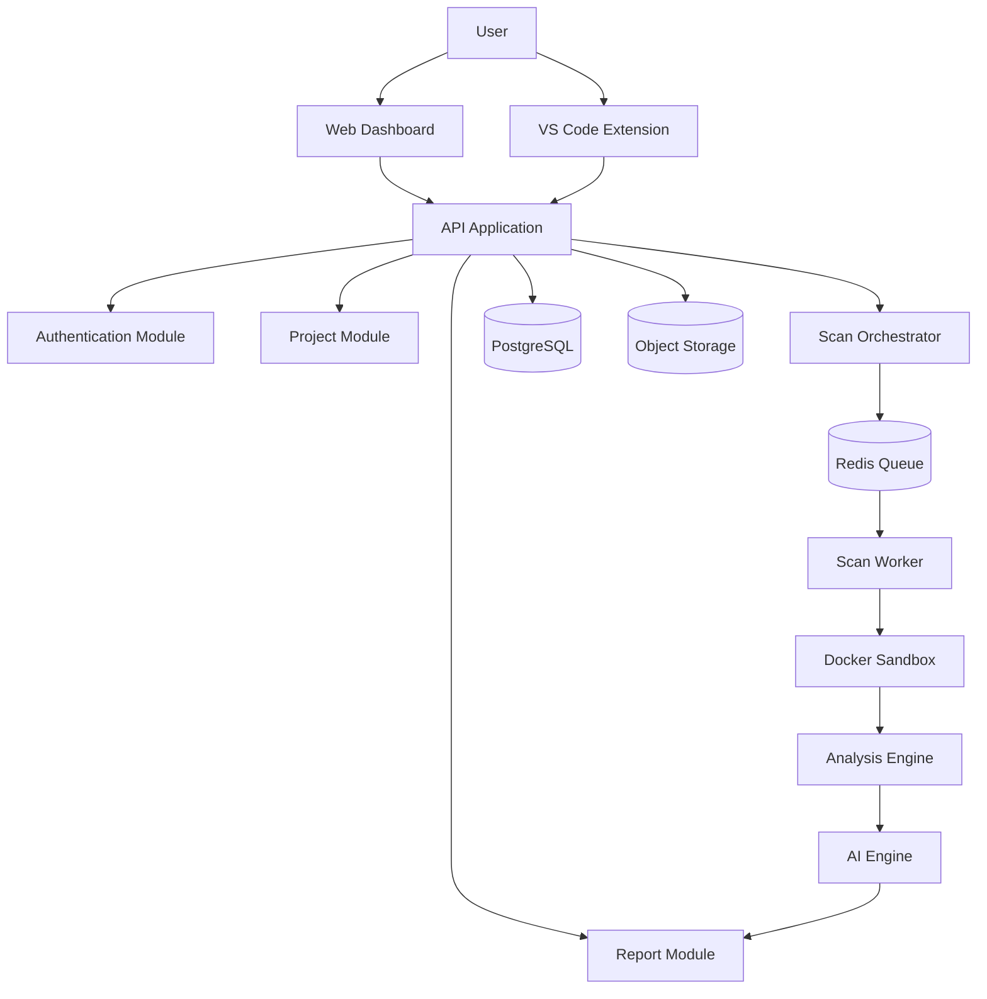

# C4 Container Architecture

## Container Responsibilities

| Container | Responsibility |
|---|---|
| Web Dashboard | User interface |
| VS Code Extension | IDE integration |
| API | Application backend |
| Scan Worker | Background processing |
| Docker Runner | Secure execution |
| Analysis Engine | Static/runtime/security analysis |
| AI Engine | Reasoning and patch generation |
| PostgreSQL | Persistent metadata |
| Redis | Queue/cache |
| Object Storage | Files and artifacts |