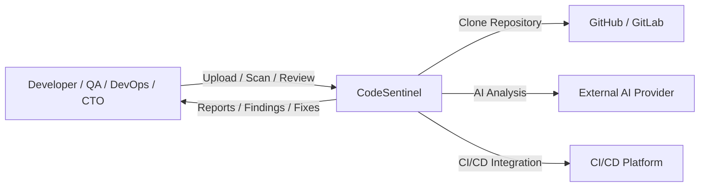

# C4 Context Diagram

## System Context

## External Actors

### Developer

Uploads projects, starts scans and reviews suggested fixes.

### QA Engineer

Reviews test results and validation reports.

### DevOps Engineer

Uses CI/CD integration and deployment validation.

### CTO

Reviews project quality and production readiness.

### Git Provider

Provides repository source code.

### AI Provider

Provides large language model capabilities.

### CI/CD Platform

Triggers automated scans during software delivery.