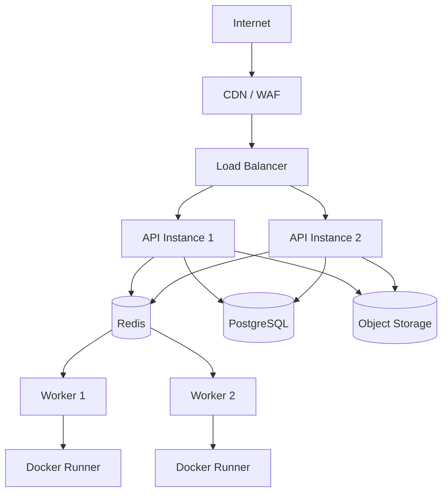

# Deployment Architecture

## Initial Production Architecture

## Scaling Strategy

API servers are stateless and can be horizontally scaled.

Workers can be independently scaled according to scan queue depth.

Docker runners are isolated and disposable.

Database scaling will initially use vertical scaling followed by read replicas when required.