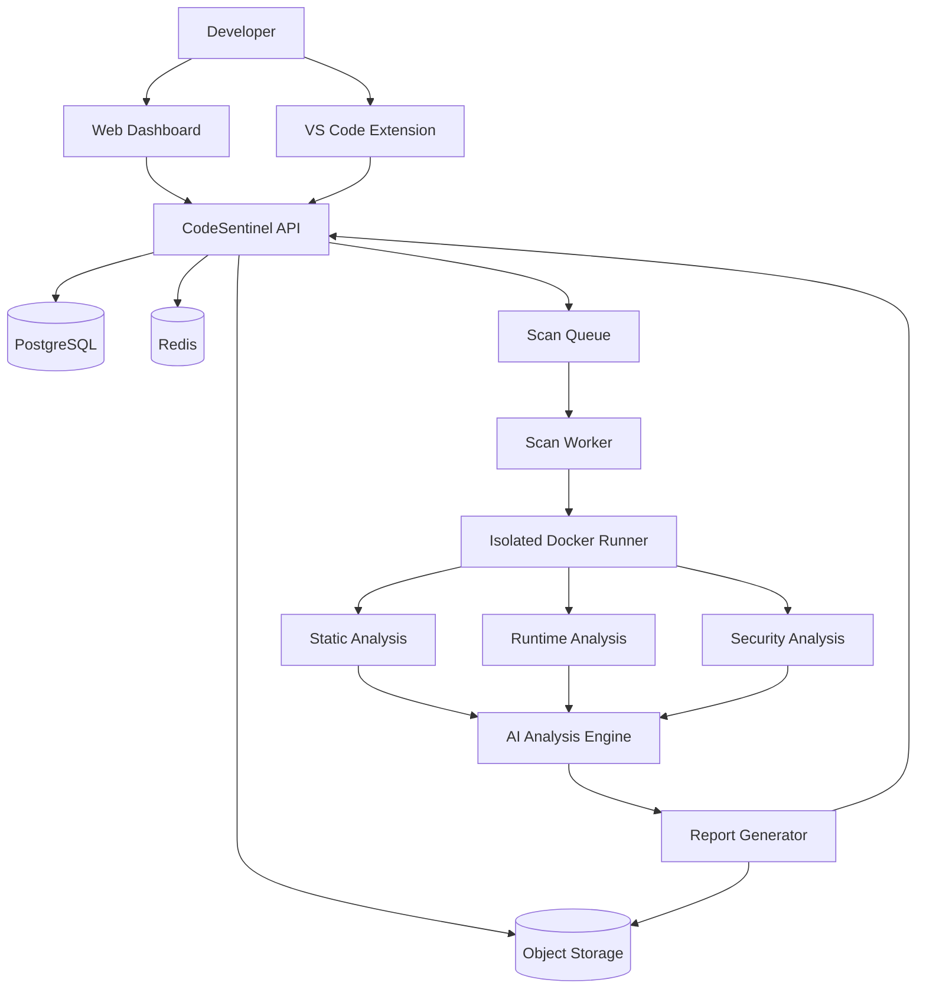

# CodeSentinel System Architecture

## Architecture Style

CodeSentinel uses a Modular Monolith + Worker Architecture for the initial production release.

The architecture is intentionally designed so individual modules can later be extracted into independent microservices.

## High-Level Flow

## Core Components

### API Server

Responsible for:

- Authentication
- Authorization
- Projects
- Repositories
- Scan management
- Reports
- User settings

### Scan Worker

Responsible for executing asynchronous scan jobs.

### Docker Runner

Provides isolated project execution.

### AI Engine

Responsible for:

- Root cause analysis
- Error classification
- Fix generation
- Fix verification

### PostgreSQL

Stores application metadata.

### Redis

Used for:

- Queue
- Cache
- Job state
- Distributed coordination

### Object Storage

Stores:

- Uploaded projects
- Build logs
- Scan artifacts
- Reports